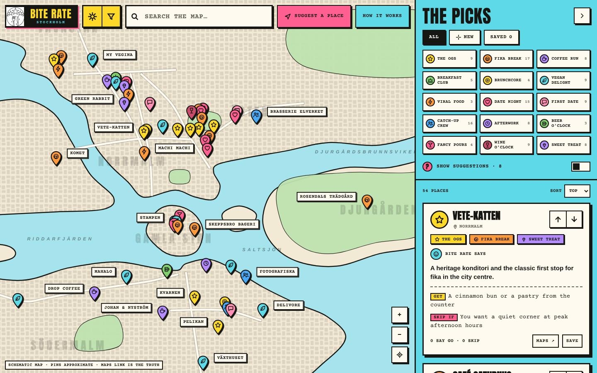

# Bite Rate · Stockholm

A retro map of Stockholm's fika spots, date-night restaurants, vegan places, bars and viral food. Pick a cut (Date Night, First Date, Catch-Up Crew, Vegan Delight, Viral Food and 10 more), say GO or SKIP, open the place in Google Maps.



Design follows the BLR CUTS system: flat colour, 0 radius, hard offset shadows, Impact-style headings, Courier labels.

## How it keeps itself running

Everything runs in GitHub Actions (`.github/workflows/site.yml`). Nothing needs your computer.

| When | What happens |
|---|---|
| Every Monday | If the shared-votes server is on, tallies are copied into `data/votes_snapshot.json` and popular suggestions become candidates. Then the **review agent** searches Google Places for one new topic (16 topics rotate), reads each new place's reviews with a small local model (Ollama, `llama3.2:3b`, installed on the runner), and adds places that pass. |
| First week of each month | The agent also looks up every place and hides ones that closed permanently (`data/closed.json`). |
| After each agent run, and on every push | Tests run, the site is built (`build.py`), a headless-browser smoke test opens it on desktop and phone, then it deploys to GitHub Pages. |

**A place is added only if** Google shows more than 5 reviews, the model judges at least 70% of the review texts it reads as positive, the model assigns it to a cut, and it is not already on the site. At most 5 places per run. Google returns up to 5 review texts per place, so the model reads those.

The agent writes `data/state.json` on every run, so the repo always has fresh activity. GitHub pauses scheduled workflows in repos that go quiet for 60 days; this prevents that.

## Move to another Windows computer

Download [Start-BiteRate.bat](https://github.com/roshanarun1991/BiteRate/raw/refs/heads/main/Start-BiteRate.bat) and double-click it. It installs missing tools, downloads the latest project, and provides a menu for Cloudflare setup, checks and continuation notes. You approve account sign-ins yourself.

Read [CONTINUE_PROJECT.md](CONTINUE_PROJECT.md) for the handoff, free-only setup and remaining work. The website and scheduled GitHub jobs continue while your computer is off.

Installer checks: `Start-BiteRate.bat --self-test` and `powershell -NoProfile -ExecutionPolicy Bypass -File Test-Transfer.ps1`. These offline checks do not install software or contact cloud accounts.

## One-time setup (5 minutes)

1. **Pages:** repo Settings → Pages → Source: **GitHub Actions**.
2. **Optional discovery API:** Google Places (New) requires a billing-enabled project and may incur charges. For a free-only setup, leave `GOOGLE_PLACES_API_KEY` unset and add editorial places by hand. Budget alerts are notifications, not spending caps.
3. Actions tab → "Bite Rate - agent, test, deploy" → Run workflow.

Without the key the site still deploys and works; the agent just skips its checks.

## Shared votes (optional, free)

GitHub Pages can't take writes from visitors (anyone could steal a token from the page). So votes go through a tiny Cloudflare Worker (`worker/`, free tier), and the weekly job copies everything into this repo.

- Visitors vote GO/SKIP with no account. Each browser gets a random device id. One vote per device per place.
- The page reads everyone's votes live and sends yours. If the server is down, voting still works on the device.
- Weekly, `agent/sync_server.py` saves all tallies to `data/votes_snapshot.json` (so they live in GitHub too) and sends any suggestion with **+5 net votes** to the review agent as a candidate.
- Anonymous means a determined person can fake votes with new browsers. There are per-IP and per-device limits, nothing stronger. Treat tallies as a crowd signal, not an election.

**Setup (10 minutes, needs a free Cloudflare account):**
```
cd worker
npx wrangler kv namespace create VOTES        # copy the id it prints into wrangler.toml
# edit wrangler.toml: set ALLOWED_ORIGIN to your Pages address
npx wrangler secret put ADMIN_TOKEN           # pick a long random string
npx wrangler deploy                           # prints https://biterate-votes.<you>.workers.dev
```
Then put that URL in `data/config.json` (`{"votes_api": "https://biterate-votes.<you>.workers.dev"}`), add the same ADMIN_TOKEN as repo secret `BITERATE_ADMIN_TOKEN`, and push. The site rebuilds with shared votes on.

Without the server the site still works; votes and suggestions stay on each visitor's device.

## What else to know

- The map uses MapLibre and OpenFreeMap for real streets and extruded 3D buildings, with day/night styles. No map API key is needed. If map loading fails, the schematic fallback remains usable and offers a retry. Building heights and coverage depend on OpenStreetMap data; venue pins are approximate.
- The hand-picked places in `src/data.js` are an editor's list, not a ranking.
- Twelve additions on 2026-10-20 bring the initial collection to 66 places. Their `source`, `website` and `checkedAt` fields record the sources used. Categories are editorial; Viral Food includes photogenic picks and is not a live social-media ranking.

## Layout

```
src/            page source: data.js (cuts + places), map.js, app1.js, shared.js, app2.js, style.css, body.html
worker/         Cloudflare Worker for shared votes + its tests
data/           places_auto.json (agent output), closed.json, state.json, candidates.json, config.json, votes_snapshot.json
agent/          bite_rate_agent.py + tests (standard library only)
tests/          test_site.py (data + build checks), smoke.py + smoke_shared.py (browser)
build.py        src + data -> dist/index.html
```

Local: `python3 tests/test_site.py && python3 build.py` then open `dist/index.html`.

Add a place by hand: add an entry to `PLACES` in `src/data.js`, including a unique id, name, area, address, approximate coordinates, cuts and short get/skip notes. Add `website`, `source`, `checkedAt` and `addedAt: Date.UTC(year, monthMinusOne, day)` for traceable new picks. Commit the file on GitHub and the site rebuilds automatically. This needs no local computer or Google key.

If discovery is configured, you can alternatively put `{"name": "Place name"}` in `data/candidates.json` for the agent to review.

Browser QA: install Playwright and Chromium, then run `python3 tests/smoke.py` and `python3 tests/smoke_shared.py`. Responsive checks cover 1440, 1280, 900, 390 and 320 pixel widths, all 15 filters, day/night persistence, fallback, search, saved-list removal, votes, sharing, forms and deep links. The shared-server test uses a mock API; it does not imply a live Worker is configured. Real map rendering is checked separately on the deployed site.

## Honest limits

- The agent approves places by review text from Google. It can be wrong. Skim `data/places_auto.json` now and then; delete a bad entry and it stays out, because `state.json` remembers it was judged.
- If Google or Ollama changes its API, the agent step fails but the site keeps deploying with the last good data.
- Check `git log` once in a while. If you never look, the site keeps running but slowly drifts.
